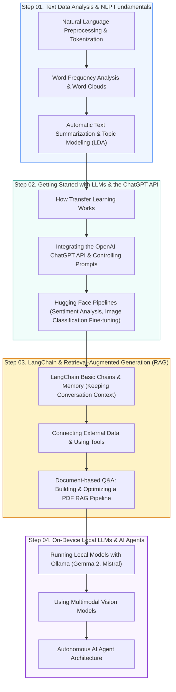

🇰🇷 [한국어](README.md) · 🇺🇸 **English** · 🇯🇵 [日本語](README.ja.md)

# 🤖 Mastering ChatGPT & Generative AI in Practice (CHATGPT_AI_CLASS)

<p align="center">
  <a href="https://ldjwj.github.io/CHATGPT_AI_CLASS/README.en.html">
    
  </a>
  
  
  
  
  
</p>

> **From text-mining fundamentals to LLMs, prompt engineering, LangChain RAG, local LLMs (Ollama), and AI agents!**  
> This is an **open online course textbook** that walks you step by step through the latest frameworks and practical techniques for building real-world applications in the era of generative AI (GenAI).  
> ⭐️ If you find it helpful, please give it a **Star** using the button at the top right!

> **Note:** All slides and notebooks (PDF/HTML) are in Korean. The code itself is language-independent, and your browser's built-in translation (e.g. Chrome) works on the HTML pages.

<p align="center">
  <a href="#️-learning-roadmap">🗺️ Learning Roadmap</a> •
  <a href="#-ai-trends--interactive-agent-visualizations">💡 Trends & Visualizations</a> •
  <a href="#-part-01-text-data-analysis-fundamentals-nlp">📄 Part 1. Text Analysis</a> •
  <a href="#-part-02-chatgpt-api--hugging-face-open-source-llms">🤗 Part 2. API & Hugging Face</a> •
  <a href="#-part-03-langchain-chatbots--pdf-rag-pipelines">🦜 Part 3. LangChain & RAG</a> •
  <a href="#-part-04-local-llms-ollama--multimodal--ai-agents">🦙 Part 4. Ollama & Agent</a>
</p>

---

## 🗺️ Learning Roadmap



---

## 💡 AI Trends & Interactive Agent Visualizations

* **AI Trends and Use Cases (including the latest v13 on vibe coding)**:
  * [📄 AI Trends and Real-World Use Cases (v12)](https://ldjwj.github.io/CHATGPT_AI_CLASS/AI트렌드및활용사례_V12_2506_Last.pdf) · [📄 Vibe Coding Special Lecture Edition (v13)](https://ldjwj.github.io/CHATGPT_AI_CLASS/AI트렌드및활용사례_V13_바이브코딩.pdf)
* **Careers and Future Outlook**:
  * [📄 Tech Jobs and Emerging Careers in the AI Era](https://ldjwj.github.io/CHATGPT_AI_CLASS/00_AI와기술분야의신흥직업들.pdf)
* **Interactive AI Agent Demos**:
  * [📄 Introduction to Basic AI Agent Architecture (PDF)](https://ldjwj.github.io/CHATGPT_AI_CLASS/08_AI_에이전트의_기본소개.pdf)
  * [🎮 Interactive In-Browser AI Agent Visualization](https://ldjwj.github.io/CHATGPT_AI_CLASS/Visualization/agent_01.html)

---

## 📄 PART 01. Text Data Analysis Fundamentals (NLP)

This foundational part covers cleaning natural-language text and extracting statistical patterns and meaning from it.

| Topic | Key Content | Textbook & Practice Links |
|:---|:---|:---:|
| **Intro to Natural Language Processing** | Text data analysis basics and a preprocessing guide | [📄 PDF](https://ldjwj.github.io/CLASS_PY_LIB_LEVELUP/00_텍스트데이터분석기본및활용_V10.pdf) · [🌐 HTML](https://ldjwj.github.io/CHATGPT_AI_CLASS/01_TextPre_V10.html) |
| **Word Frequency Analysis** | Frequency counting based on morphological analysis & word cloud visualization | [🌐 HTML](https://ldjwj.github.io/CLASS_PY_LIB_LEVELUP/06_DATA_ANALYSIS/텍스트데이터분석1_빈도분석_wc_V112.html) · [📄 PDF](https://ldjwj.github.io/CLASS_PY_LIB_LEVELUP/06_DATA_ANALYSIS/텍스트데이터분석1_빈도분석_wc_V112.pdf) |
| **Automatic Text Summarization** | Summarizing long documents by extracting key sentences | [🌐 HTML](https://ldjwj.github.io/CLASS_PY_LIB_LEVELUP/06_DATA_ANALYSIS/텍스트데이터분석2_요약_wc_V112.html) · [📄 PDF](https://ldjwj.github.io/CLASS_PY_LIB_LEVELUP/06_DATA_ANALYSIS/텍스트데이터분석2_요약_wc_V12.pdf) |
| **Topic Modeling** | Document clustering with Latent Dirichlet Allocation (LDA) | [🌐 HTML](https://ldjwj.github.io/CLASS_PY_LIB_LEVELUP/06_DATA_ANALYSIS/텍스트데이터분석3_토픽모델링_wc_V112.html) · [📄 PDF](https://ldjwj.github.io/CLASS_PY_LIB_LEVELUP/06_DATA_ANALYSIS/텍스트데이터분석3_토픽모델링_wc_V12.pdf) |

---

## 🤗 PART 02. ChatGPT API & Hugging Face Open-Source LLMs

Covers everything from OpenAI's commercial API to fine-tuning open-source Transformer models from Hugging Face.

```
┌────────────────────────────┐      ┌────────────────────────────┐      ┌────────────────────────────┐
│  🔑 OpenAI API Integration │ ---> │  🤗 Hugging Face Pipelines │ ---> │  ⚙️ Model Fine-tuning      │
│  - Chat Completion         │      │  - Sentiment analysis      │      │  - Image classification    │
│  - System/User prompts     │      │  - Open-source pretrained  │      │    via transfer learning   │
│                            │      │    models                  │      │  - Custom datasets         │
└────────────────────────────┘      └────────────────────────────┘      └────────────────────────────┘
```

### 1. Hands-on with the OpenAI ChatGPT API
* **Getting Started with LLMs (textbook)**: [📄 PDF Textbook](https://ldjwj.github.io/CHATGPT_AI_CLASS/LLM시작하기_V11_PDF.pdf)
* **Understanding Transfer Learning**: [🌐 HTML](https://ldjwj.github.io/CHATGPT_AI_CLASS/03_전이학습_V10.html) · [📄 PDF](https://ldjwj.github.io/CHATGPT_AI_CLASS/03_전이학습_V10.pdf)
* **Getting Started with the API: Basic Examples (1, 2)**:  
  * Example 1: [🌐 HTML](https://ldjwj.github.io/CHATGPT_AI_CLASS/04_CHATGPTAPI_BASIC02_API시작하기_wc_v10_2504.html) · [📄 PDF](https://ldjwj.github.io/CHATGPT_AI_CLASS/04_CHATGPTAPI_BASIC02_API시작하기_wc_v10_2504.pdf)  
  * Example 2: [🌐 HTML](https://ldjwj.github.io/CHATGPT_AI_CLASS/04_ChatGPTAPI_BASIC_V11.html) · [📄 PDF](https://ldjwj.github.io/CHATGPT_AI_CLASS/04_ChatGPTAPI_BASIC_V11.pdf)
* **Understanding the GPT-2/GPT-3 Architecture, with Practice**: [🌐 HTML](https://ldjwj.github.io/CHATGPT_AI_CLASS/03_GPT2_Pratice_wc_v10.html) · [📄 PDF](https://ldjwj.github.io/CHATGPT_AI_CLASS/03_GPT3_Pratice_v10_Colab.pdf)

### 2. The Hugging Face Open-Source Ecosystem (One-Click Colab Practice)
* **Basic Pipeline Practice**: [🌐 HTML](https://ldjwj.github.io/CHATGPT_AI_CLASS/05_HuggingFace_Basic_V11.html) · [📄 PDF](https://ldjwj.github.io/CHATGPT_AI_CLASS/05_HuggingFace_BasicA_V10.pdf)  
  [](https://colab.research.google.com/github/LDJWJ/CHATGPT_AI_CLASS/blob/main/code/05_HuggingFace_BasicA_V10_2510.ipynb)
* **Sentiment Analysis Model Practice**: [📄 PDF](https://ldjwj.github.io/CHATGPT_AI_CLASS/05_HuggingFace_BasicB_V13.pdf)  
  [](https://colab.research.google.com/github/LDJWJ/CHATGPT_AI_CLASS/blob/main/code/05_HuggingFace_BasicB_V13_WC_2510.ipynb)
* **Vision Transformer (ViT) Image Classification & Fine-tuning**: [📄 PDF](https://ldjwj.github.io/CHATGPT_AI_CLASS/05_HuggingFace_IntmdA_img_FingTunning_WC.pdf)  
  [](https://colab.research.google.com/github/LDJWJ/CHATGPT_AI_CLASS/blob/main/code/05_HuggingFace_IntermediateA_img_FingTunning_V10_2510.ipynb)

---

## 🦜 PART 03. LangChain Chatbots & PDF RAG Pipelines

Using the LangChain framework, you will go beyond simple Q&A to build **retrieval-augmented generation (RAG)** systems and stateful chatbots.

| Topic | Details | Textbook & Practice Links |
|:---|:---|:---:|
| **Basic Chains** | Getting started with LangChain & LLMChain basics | [🌐 HTML](https://ldjwj.github.io/CHATGPT_AI_CLASS/LangChain/01_LangChain_Start_V10.html) |
| **Building a Chatbot** | Building a conversational chatbot interface | [🌐 HTML](https://ldjwj.github.io/CHATGPT_AI_CLASS/LangChain/01_LangChain_간단한챗봇_V10_2411.html) · [📄 PDF](https://ldjwj.github.io/CHATGPT_AI_CLASS/LangChain/01_LangChain_간단한챗봇_V10_2411.pdf) |
| **Sentiment Classification Chain** | Combining prompt templates with output parsers | [🌐 HTML](https://ldjwj.github.io/CHATGPT_AI_CLASS/LangChain/02_LangChain_TextClassfication_V10.html) · [📄 PDF](https://ldjwj.github.io/CHATGPT_AI_CLASS/LangChain/02_LangChain_TextClassfication_V10.pdf) |
| **Memory** | Keeping the context of previous turns (ConversationBufferMemory) | [🌐 HTML](https://ldjwj.github.io/CHATGPT_AI_CLASS/LangChain/03_LangChain_맥락이어가기_local_V10_2411.html) · [📄 PDF](https://ldjwj.github.io/CHATGPT_AI_CLASS/LangChain/03_LangChain_맥락이어가기_local_V10_2411.pdf) |
| **Connecting External Data** | Integrating WebBaseLoader, CSV, and document loaders | [🌐 HTML](https://ldjwj.github.io/CHATGPT_AI_CLASS/LangChain/04_LangChain_외부데이터연결_local_V10_2411.html) · [📄 PDF](https://ldjwj.github.io/CHATGPT_AI_CLASS/LangChain/04_LangChain_외부데이터연결_local_V10_2411.pdf) |
| **PDF RAG Basics** | Text chunking, embeddings, and Q&A over a vector store | [🌐 HTML](https://ldjwj.github.io/CHATGPT_AI_CLASS/LangChain/05_LangChain_PDF_RAG_V10.html) · [📄 PDF](https://ldjwj.github.io/CHATGPT_AI_CLASS/LangChain/05_LangChain_PDF_RAG_V10.pdf) |
| **Advanced PDF RAG** | RAG v2 with retriever optimization & improved prompts | [🌐 HTML](https://ldjwj.github.io/CHATGPT_AI_CLASS/LangChain/06_LangChain_PDF_RAG2_V10.html) · [📄 PDF](https://ldjwj.github.io/CHATGPT_AI_CLASS/LangChain/05_LangChain_PDF_RAG_V10.pdf) |

---

## 🦙 PART 04. Local LLMs (Ollama) & Multimodal & AI Agents

Learn how to run lightweight open-source LLMs privately on your own PC without any external cloud API, and how to build autonomous agents.

* **🦙 Local LLMs & Multimodal with Ollama**:
  * Installing Ollama and running local models (Gemma 2, Mistral, LLaMA 3)
  * Multimodal practice that combines image input with text reasoning
  * [🌐 HTML Viewer](https://ldjwj.github.io/CHATGPT_AI_CLASS/LangChain/07_ollama_start_V11_2411.html) · [📄 PDF Textbook](https://ldjwj.github.io/CHATGPT_AI_CLASS/LangChain/07_ollama_start_V11_2411.pdf)
* **🤖 Autonomous AI Agents**:
  * The three components of an agent: Planning, Memory, and Tool Use
  * The ReAct (Reasoning + Acting) prompting pattern and building real-world agents

---

## 🛠️ Development Environment Setup & License

* **OpenAI API setup**:
  ```bash
  pip install openai langchain langchain-community langchain-openai chromadb
  export OPENAI_API_KEY="your-api-key-here"
  ```
* **Running Ollama locally**:
  ```bash
  # Example: running an Ollama model
  ollama run gemma2
  ```
* **Contact**: For copyright inquiries and partnerships: [frontier1020@naver.com](mailto:frontier1020@naver.com)
* **License**: All materials in this repository are licensed under [CC BY-NC 4.0](LICENSE). You are free to use them for non-commercial purposes as long as you give appropriate credit.
