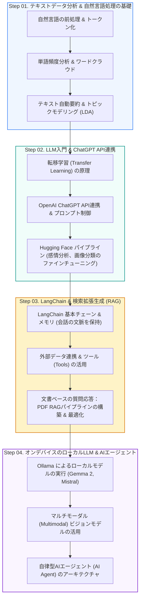

🇰🇷 [한국어](README.md) · 🇺🇸 [English](README.en.md) · 🇯🇵 **日本語**

# 🤖 ChatGPT & 生成AI 実践マスター (CHATGPT_AI_CLASS)

<p align="center">
  <a href="https://ldjwj.github.io/CHATGPT_AI_CLASS/README.ja.html">
    
  </a>
  
  
  
  
  
</p>

> **テキストマイニングの基礎から、LLM、プロンプトエンジニアリング、LangChain RAG、ローカルLLM（Ollama）、AIエージェントまで！**  
> 生成AI（GenAI）時代をリードする最新フレームワークと、実務アプリケーションの構築手法を段階的に学べる **オンライン公開講座の教材** です。  
> ⭐️ 学習のお役に立ちましたら、右上の **Star** ボタンをぜひ押してください！

> **ご注意：** 教材（PDF/HTML）はすべて **韓国語** で書かれています。コードはそのまま実行でき、HTMLページはブラウザ（Chromeなど）の自動翻訳で読むことができます。

<p align="center">
  <a href="#️-学習ロードマップ">🗺️ 学習ロードマップ</a> •
  <a href="#-aiトレンド--エージェントのインタラクティブ可視化">💡 トレンド & 可視化</a> •
  <a href="#-part-01-テキストデータ分析の基礎-nlp">📄 Part 1. テキスト分析</a> •
  <a href="#-part-02-chatgpt-api--hugging-face-オープンソースllm">🤗 Part 2. API & Hugging Face</a> •
  <a href="#-part-03-langchain-チャットボット--pdf-rag-パイプライン">🦜 Part 3. LangChain & RAG</a> •
  <a href="#-part-04-ローカルllm-ollama--マルチモーダル--aiエージェント">🦙 Part 4. Ollama & Agent</a>
</p>

---

## 🗺️ 学習ロードマップ



---

## 💡 AIトレンド & エージェントのインタラクティブ可視化

* **AIトレンドと活用事例（最新 v13 バイブコーディング版を含む）**:
  * [📄 AIトレンドと実務での活用事例 (v12)](https://ldjwj.github.io/CHATGPT_AI_CLASS/AI트렌드및활용사례_V12_2506_Last.pdf) · [📄 バイブコーディング特別講義版 (v13)](https://ldjwj.github.io/CHATGPT_AI_CLASS/AI트렌드및활용사례_V13_바이브코딩.pdf)
* **職業と将来展望**:
  * [📄 AI時代の技術職と新たな職業の展望](https://ldjwj.github.io/CHATGPT_AI_CLASS/00_AI와기술분야의신흥직업들.pdf)
* **AIエージェントのインタラクティブデモ**:
  * [📄 AIエージェントの基本アーキテクチャ紹介 PDF](https://ldjwj.github.io/CHATGPT_AI_CLASS/08_AI_에이전트의_기본소개.pdf)
  * [🎮 Webブラウザで動くAIエージェントのインタラクティブ可視化](https://ldjwj.github.io/CHATGPT_AI_CLASS/Visualization/agent_01.html)

---

## 📄 PART 01. テキストデータ分析の基礎 (NLP)

自然言語のテキストを整形し、統計的なパターンや意味を抽出する基礎パートです。

| テーマ | 主な内容 | 教材・実習リンク |
|:---|:---|:---:|
| **自然言語処理入門** | テキストデータ分析の基本と前処理ガイド | [📄 PDF](https://ldjwj.github.io/CLASS_PY_LIB_LEVELUP/00_텍스트데이터분석기본및활용_V10.pdf) · [🌐 HTML](https://ldjwj.github.io/CHATGPT_AI_CLASS/01_TextPre_V10.html) |
| **単語頻度分析** | 形態素解析にもとづく頻度集計 & ワードクラウドによる可視化 | [🌐 HTML](https://ldjwj.github.io/CLASS_PY_LIB_LEVELUP/06_DATA_ANALYSIS/텍스트데이터분석1_빈도분석_wc_V112.html) · [📄 PDF](https://ldjwj.github.io/CLASS_PY_LIB_LEVELUP/06_DATA_ANALYSIS/텍스트데이터분석1_빈도분석_wc_V112.pdf) |
| **テキスト自動要約** | 重要文の抽出にもとづく長文ドキュメントの要約モデル | [🌐 HTML](https://ldjwj.github.io/CLASS_PY_LIB_LEVELUP/06_DATA_ANALYSIS/텍스트데이터분석2_요약_wc_V112.html) · [📄 PDF](https://ldjwj.github.io/CLASS_PY_LIB_LEVELUP/06_DATA_ANALYSIS/텍스트데이터분석2_요약_wc_V12.pdf) |
| **トピックモデリング** | 潜在的ディリクレ配分法（LDA）による文書のクラスタリング | [🌐 HTML](https://ldjwj.github.io/CLASS_PY_LIB_LEVELUP/06_DATA_ANALYSIS/텍스트데이터분석3_토픽모델링_wc_V112.html) · [📄 PDF](https://ldjwj.github.io/CLASS_PY_LIB_LEVELUP/06_DATA_ANALYSIS/텍스트데이터분석3_토픽모델링_wc_V12.pdf) |

---

## 🤗 PART 02. ChatGPT API & Hugging Face オープンソースLLM

OpenAIの商用APIから、Hugging Faceのオープンソース Transformer モデルのファインチューニングまでを扱います。

```
┌──────────────────────────┐      ┌──────────────────────────┐      ┌──────────────────────────┐
│  🔑 OpenAI API連携       │ ---> │  🤗 Hugging Face         │ ---> │  ⚙️ ファインチューニング │
│  - Chat Completion       │      │     パイプライン         │      │  - 画像分類の転移学習    │
│  - System/User プロンプト│      │  - 感情分析パイプライン  │      │  - 独自データセットの適用│
│                          │      │  - OSS 事前学習済みモデル│      │                          │
└──────────────────────────┘      └──────────────────────────┘      └──────────────────────────┘
```

### 1. OpenAI ChatGPT API 実習
* **LLM入門 教材**: [📄 PDF教材](https://ldjwj.github.io/CHATGPT_AI_CLASS/LLM시작하기_V11_PDF.pdf)
* **転移学習（Transfer Learning）の理解**: [🌐 HTML](https://ldjwj.github.io/CHATGPT_AI_CLASS/03_전이학습_V10.html) · [📄 PDF](https://ldjwj.github.io/CHATGPT_AI_CLASS/03_전이학습_V10.pdf)
* **APIをはじめよう：基本サンプル (1, 2)**:  
  * サンプル 1: [🌐 HTML](https://ldjwj.github.io/CHATGPT_AI_CLASS/04_CHATGPTAPI_BASIC02_API시작하기_wc_v10_2504.html) · [📄 PDF](https://ldjwj.github.io/CHATGPT_AI_CLASS/04_CHATGPTAPI_BASIC02_API시작하기_wc_v10_2504.pdf)  
  * サンプル 2: [🌐 HTML](https://ldjwj.github.io/CHATGPT_AI_CLASS/04_ChatGPTAPI_BASIC_V11.html) · [📄 PDF](https://ldjwj.github.io/CHATGPT_AI_CLASS/04_ChatGPTAPI_BASIC_V11.pdf)
* **GPT-2/GPT-3 の構造理解と実習**: [🌐 HTML](https://ldjwj.github.io/CHATGPT_AI_CLASS/03_GPT2_Pratice_wc_v10.html) · [📄 PDF](https://ldjwj.github.io/CHATGPT_AI_CLASS/03_GPT3_Pratice_v10_Colab.pdf)

### 2. Hugging Face オープンソースエコシステム（Colab ワンクリック実習）
* **基本パイプライン実習**: [🌐 HTML](https://ldjwj.github.io/CHATGPT_AI_CLASS/05_HuggingFace_Basic_V11.html) · [📄 PDF](https://ldjwj.github.io/CHATGPT_AI_CLASS/05_HuggingFace_BasicA_V10.pdf)  
  [](https://colab.research.google.com/github/LDJWJ/CHATGPT_AI_CLASS/blob/main/code/05_HuggingFace_BasicA_V10_2510.ipynb)
* **感情分析モデル実習**: [📄 PDF](https://ldjwj.github.io/CHATGPT_AI_CLASS/05_HuggingFace_BasicB_V13.pdf)  
  [](https://colab.research.google.com/github/LDJWJ/CHATGPT_AI_CLASS/blob/main/code/05_HuggingFace_BasicB_V13_WC_2510.ipynb)
* **Vision Transformer（ViT）による画像分類 & ファインチューニング**: [📄 PDF](https://ldjwj.github.io/CHATGPT_AI_CLASS/05_HuggingFace_IntmdA_img_FingTunning_WC.pdf)  
  [](https://colab.research.google.com/github/LDJWJ/CHATGPT_AI_CLASS/blob/main/code/05_HuggingFace_IntermediateA_img_FingTunning_V10_2510.ipynb)

---

## 🦜 PART 03. LangChain チャットボット & PDF RAG パイプライン

LangChain フレームワークを活用し、単純な質問応答にとどまらず、**検索拡張生成（RAG）** と状態を管理するチャットボットを構築します。

| テーマ | 詳細 | 教材・実習リンク |
|:---|:---|:---:|
| **基本チェーン** | LangChain 入門 & LLMChain の基本 | [🌐 HTML](https://ldjwj.github.io/CHATGPT_AI_CLASS/LangChain/01_LangChain_Start_V10.html) |
| **チャットボット作成** | 対話型チャットボットのインターフェース構築 | [🌐 HTML](https://ldjwj.github.io/CHATGPT_AI_CLASS/LangChain/01_LangChain_간단한챗봇_V10_2411.html) · [📄 PDF](https://ldjwj.github.io/CHATGPT_AI_CLASS/LangChain/01_LangChain_간단한챗봇_V10_2411.pdf) |
| **感情分類チェーン** | プロンプトテンプレートと出力パーサーの組み合わせ | [🌐 HTML](https://ldjwj.github.io/CHATGPT_AI_CLASS/LangChain/02_LangChain_TextClassfication_V10.html) · [📄 PDF](https://ldjwj.github.io/CHATGPT_AI_CLASS/LangChain/02_LangChain_TextClassfication_V10.pdf) |
| **メモリ（Memory）** | 過去の会話の文脈を保持（ConversationBufferMemory） | [🌐 HTML](https://ldjwj.github.io/CHATGPT_AI_CLASS/LangChain/03_LangChain_맥락이어가기_local_V10_2411.html) · [📄 PDF](https://ldjwj.github.io/CHATGPT_AI_CLASS/LangChain/03_LangChain_맥락이어가기_local_V10_2411.pdf) |
| **外部データ連携** | WebBaseLoader、CSV、ドキュメントローダーとの連携 | [🌐 HTML](https://ldjwj.github.io/CHATGPT_AI_CLASS/LangChain/04_LangChain_외부데이터연결_local_V10_2411.html) · [📄 PDF](https://ldjwj.github.io/CHATGPT_AI_CLASS/LangChain/04_LangChain_외부데이터연결_local_V10_2411.pdf) |
| **PDF RAG 基礎** | テキストのチャンク分割、埋め込み、ベクトルストアによる質問応答 | [🌐 HTML](https://ldjwj.github.io/CHATGPT_AI_CLASS/LangChain/05_LangChain_PDF_RAG_V10.html) · [📄 PDF](https://ldjwj.github.io/CHATGPT_AI_CLASS/LangChain/05_LangChain_PDF_RAG_V10.pdf) |
| **PDF RAG 応用** | リトリーバーの最適化 & プロンプト改善による RAG v2 | [🌐 HTML](https://ldjwj.github.io/CHATGPT_AI_CLASS/LangChain/06_LangChain_PDF_RAG2_V10.html) · [📄 PDF](https://ldjwj.github.io/CHATGPT_AI_CLASS/LangChain/05_LangChain_PDF_RAG_V10.pdf) |

---

## 🦙 PART 04. ローカルLLM (Ollama) & マルチモーダル & AIエージェント

外部のクラウドAPIを使わずに、ローカルPC上で軽量なオープンソースLLMをプライベートに運用する方法と、自律型エージェントを学びます。

* **🦙 Ollama によるローカルLLM & マルチモーダル**:
  * Ollama のインストールとローカルモデルの実行（Gemma 2、Mistral、LLaMA 3）
  * 画像入力とテキスト推論を同時に行うマルチモーダル（Multimodal）実習
  * [🌐 HTMLビューア](https://ldjwj.github.io/CHATGPT_AI_CLASS/LangChain/07_ollama_start_V11_2411.html) · [📄 PDF教材](https://ldjwj.github.io/CHATGPT_AI_CLASS/LangChain/07_ollama_start_V11_2411.pdf)
* **🤖 自律型AIエージェント（Autonomous AI Agent）**:
  * 計画立案（Planning）、メモリ（Memory）、ツール利用（Tool Use）というエージェントの3要素
  * ReAct（Reasoning + Acting）プロンプトパターンと実践的なエージェントの実装

---

## 🛠️ 開発環境のセットアップ & ライセンス

* **OpenAI API の設定**:
  ```bash
  pip install openai langchain langchain-community langchain-openai chromadb
  export OPENAI_API_KEY="your-api-key-here"
  ```
* **Ollama のローカル実行**:
  ```bash
  # Ollama モデルの実行例
  ollama run gemma2
  ```
* **お問い合わせ**: 著作権に関するお問い合わせ・その他の提携: [frontier1020@naver.com](mailto:frontier1020@naver.com)
* **ライセンス**: 本リポジトリのすべての資料は [CC BY-NC 4.0](LICENSE) ライセンスに従います。出典を明記すれば、非営利目的で自由にご利用いただけます。
