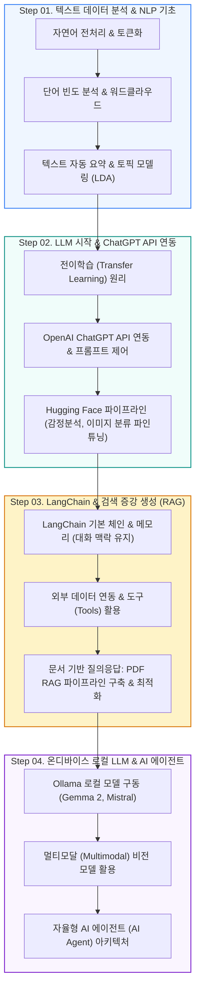

# 🤖 ChatGPT & 생성형 AI 실전 마스터 (CHATGPT_AI_CLASS)

<p align="center">
  <a href="https://ldjwj.github.io/CHATGPT_AI_CLASS/">
    
  </a>
  
  
  
  
  
</p>

> **텍스트 마이닝 기초부터 LLM, 프롬프트 엔지니어링, LangChain RAG, 로컬 LLM(Ollama), AI 에이전트까지!**  
> 생성형 AI(GenAI) 시대를 선도하는 최신 프레임워크와 실무 애플리케이션 구축 기법을 단계별로 학습할 수 있는 **온라인 오픈 강의 교재**입니다.  
> ⭐️ 학습에 도움이 되셨다면 우측 상단의 **Star** 버튼을 꾹 눌러주세요!

<p align="center">
  <a href="#-학습-로드맵">🗺️ 학습 로드맵</a> •
  <a href="#-ai-트렌드--에이전트-시각화">💡 트렌드 & 시각화</a> •
  <a href="#-part-01-텍스트-데이터-분석-기초-nlp">📄 Part 1. 텍스트 분석</a> •
  <a href="#-part-02-chatgpt-api--hugging-face-오픈소스-llm">🤗 Part 2. API & Hugging Face</a> •
  <a href="#-part-03-langchain-챗봇--pdf-rag-파이프라인">🦜 Part 3. LangChain & RAG</a> •
  <a href="#-part-04-로컬-llm-ollama--멀티모달--ai-에이전트">🦙 Part 4. Ollama & Agent</a>
</p>

---

## 🗺️ 학습 로드맵



---

## 💡 AI 트렌드 & 에이전트 인터랙티브 시각화

* **AI 트렌드 및 활용 사례 (최신 v13 바이브코딩 포함)**:
  * [📄 AI 트렌드 및 실무 활용사례 (v12)](https://ldjwj.github.io/CHATGPT_AI_CLASS/AI트렌드및활용사례_V12_2506_Last.pdf) · [📄 바이브 코딩 특강 버전 (v13)](https://ldjwj.github.io/CHATGPT_AI_CLASS/AI트렌드및활용사례_V13_바이브코딩.pdf)
* **직업 및 미래 전망**:
  * [📄 AI 시대의 기술 직무와 신흥 직업 전망](https://ldjwj.github.io/CHATGPT_AI_CLASS/00_AI와기술분야의신흥직업들.pdf)
* **AI 에이전트 인터랙티브 데모**:
  * [📄 AI Agent 기본 아키텍처 소개 PDF](https://ldjwj.github.io/CHATGPT_AI_CLASS/08_AI_에이전트의_기본소개.pdf)
  * [🎮 웹 브라우저 AI Agent 인터랙티브 시각화](https://ldjwj.github.io/CHATGPT_AI_CLASS/Visualization/agent_01.html)

---

## 📄 PART 01. 텍스트 데이터 분석 기초 (NLP)

자연어 텍스트를 정제하고 통계적 패턴과 의미를 추출하는 기초 파트입니다.

| 주제 | 핵심 내용 | 교재 및 실습 링크 |
|:---|:---|:---:|
| **자연어 처리 입문** | 텍스트 데이터 분석 기본 및 전처리 가이드 | [📄 PDF](https://ldjwj.github.io/CLASS_PY_LIB_LEVELUP/00_텍스트데이터분석기본및활용_V10.pdf) · [🌐 HTML](https://ldjwj.github.io/CHATGPT_AI_CLASS/01_TextPre_V10.html) |
| **단어 빈도 분석** | 형태소 분석 기반 빈도수 계산 & 워드클라우드 시각화 | [🌐 HTML](https://ldjwj.github.io/CLASS_PY_LIB_LEVELUP/06_DATA_ANALYSIS/텍스트데이터분석1_빈도분석_wc_V112.html) · [📄 PDF](https://ldjwj.github.io/CLASS_PY_LIB_LEVELUP/06_DATA_ANALYSIS/텍스트데이터분석1_빈도분석_wc_V112.pdf) |
| **텍스트 자동 요약** | 핵심 문장 추출 기반 긴 문서 요약 모델 | [🌐 HTML](https://ldjwj.github.io/CLASS_PY_LIB_LEVELUP/06_DATA_ANALYSIS/텍스트데이터분석2_요약_wc_V112.html) · [📄 PDF](https://ldjwj.github.io/CLASS_PY_LIB_LEVELUP/06_DATA_ANALYSIS/텍스트데이터분석2_요약_wc_V12.pdf) |
| **토픽 모델링** | 잠재 디리클레 할당(LDA) 기반 문서 군집화 | [🌐 HTML](https://ldjwj.github.io/CLASS_PY_LIB_LEVELUP/06_DATA_ANALYSIS/텍스트데이터분석3_토픽모델링_wc_V112.html) · [📄 PDF](https://ldjwj.github.io/CLASS_PY_LIB_LEVELUP/06_DATA_ANALYSIS/텍스트데이터분석3_토픽모델링_wc_V12.pdf) |

---

## 🤗 PART 02. ChatGPT API & Hugging Face 오픈소스 LLM

OpenAI의 상용 API부터 Hugging Face의 오픈소스 트랜스포머 모델 파인튜닝까지 다룹니다.

```
┌────────────────────────┐      ┌────────────────────────┐      ┌────────────────────────┐
│  🔑 OpenAI API 연동     │ ---> │  🤗 Hugging Face 파이프라인│ ---> │  ⚙️ 모델 미세조정(Fine-tuning)│
│  - Chat Completion     │      │  - 감정 분석 파이프라인│      │  - 이미지 분류 전이학습│
│  - System/User 프롬프트 │      │  - 오픈소스 사전학습 모델│      │  - 커스텀 데이터셋 적용│
└────────────────────────┘      └────────────────────────┘      └────────────────────────┘
```

### 1. OpenAI ChatGPT API 실습
* **LLM 시작하기 교재**: [📄 PDF 교재](https://ldjwj.github.io/CHATGPT_AI_CLASS/LLM시작하기_V11_PDF.pdf)
* **전이학습(Transfer Learning)의 이해**: [🌐 HTML](https://ldjwj.github.io/CHATGPT_AI_CLASS/03_전이학습_V10.html) · [📄 PDF](https://ldjwj.github.io/CHATGPT_AI_CLASS/03_전이학습_V10.pdf)
* **API 시작하기 기본 예제 (1, 2)**:  
  * 예제 1: [🌐 HTML](https://ldjwj.github.io/CHATGPT_AI_CLASS/04_CHATGPTAPI_BASIC02_API시작하기_wc_v10_2504.html) · [📄 PDF](https://ldjwj.github.io/CHATGPT_AI_CLASS/04_CHATGPTAPI_BASIC02_API시작하기_wc_v10_2504.pdf)  
  * 예제 2: [🌐 HTML](https://ldjwj.github.io/CHATGPT_AI_CLASS/04_ChatGPTAPI_BASIC_V11.html) · [📄 PDF](https://ldjwj.github.io/CHATGPT_AI_CLASS/04_ChatGPTAPI_BASIC_V11.pdf)
* **GPT-2/GPT-3 구조 이해 및 실습**: [🌐 HTML](https://ldjwj.github.io/CHATGPT_AI_CLASS/03_GPT2_Pratice_wc_v10.html) · [📄 PDF](https://ldjwj.github.io/CHATGPT_AI_CLASS/03_GPT3_Pratice_v10_Colab.pdf)

### 2. Hugging Face 오픈소스 생태계 (Colab 원클릭 실습)
* **기본 파이프라인 실습**: [🌐 HTML](https://ldjwj.github.io/CHATGPT_AI_CLASS/05_HuggingFace_Basic_V11.html) · [📄 PDF](https://ldjwj.github.io/CHATGPT_AI_CLASS/05_HuggingFace_BasicA_V10.pdf)  
  [](https://colab.research.google.com/github/LDJWJ/CHATGPT_AI_CLASS/blob/main/code/05_HuggingFace_BasicA_V10_2510.ipynb)
* **감정 분석 모델 실습**: [📄 PDF](https://ldjwj.github.io/CHATGPT_AI_CLASS/05_HuggingFace_BasicB_V13.pdf)  
  [](https://colab.research.google.com/github/LDJWJ/CHATGPT_AI_CLASS/blob/main/code/05_HuggingFace_BasicB_V13_WC_2510.ipynb)
* **비전 트랜스포머(ViT) 이미지 분류 & 파인튜닝**: [📄 PDF](https://ldjwj.github.io/CHATGPT_AI_CLASS/05_HuggingFace_IntmdA_img_FingTunning_WC.pdf)  
  [](https://colab.research.google.com/github/LDJWJ/CHATGPT_AI_CLASS/blob/main/code/05_HuggingFace_IntermediateA_img_FingTunning_V10_2510.ipynb)

---

## 🦜 PART 03. LangChain 챗봇 & PDF RAG 파이프라인

LangChain 프레임워크를 활용하여 단순 질의응답을 넘어 **문서 검색 기반 생성(RAG)**과 상태 관리 챗봇을 구축합니다.

| 주제 | 상세 내용 | 교재 및 실습 링크 |
|:---|:---|:---:|
| **기초 체인** | LangChain 시작하기 & LLMChain 기본 | [🌐 HTML](https://ldjwj.github.io/CHATGPT_AI_CLASS/LangChain/01_LangChain_Start_V10.html) |
| **챗봇 제작** | 대화형 챗봇 인터페이스 구축 | [🌐 HTML](https://ldjwj.github.io/CHATGPT_AI_CLASS/LangChain/01_LangChain_간단한챗봇_V10_2411.html) · [📄 PDF](https://ldjwj.github.io/CHATGPT_AI_CLASS/LangChain/01_LangChain_간단한챗봇_V10_2411.pdf) |
| **감성 분류 체인** | 프롬프트 템플릿과 출력 파서 결합 | [🌐 HTML](https://ldjwj.github.io/CHATGPT_AI_CLASS/LangChain/02_LangChain_TextClassfication_V10.html) · [📄 PDF](https://ldjwj.github.io/CHATGPT_AI_CLASS/LangChain/02_LangChain_TextClassfication_V10.pdf) |
| **메모리(Memory)** | 이전 대화 맥락 유지 (ConversationBufferMemory) | [🌐 HTML](https://ldjwj.github.io/CHATGPT_AI_CLASS/LangChain/03_LangChain_맥락이어가기_local_V10_2411.html) · [📄 PDF](https://ldjwj.github.io/CHATGPT_AI_CLASS/LangChain/03_LangChain_맥락이어가기_local_V10_2411.pdf) |
| **외부 데이터 연동** | WebBaseLoader, CSV, 문서 로더 연동 | [🌐 HTML](https://ldjwj.github.io/CHATGPT_AI_CLASS/LangChain/04_LangChain_외부데이터연결_local_V10_2411.html) · [📄 PDF](https://ldjwj.github.io/CHATGPT_AI_CLASS/LangChain/04_LangChain_외부데이터연결_local_V10_2411.pdf) |
| **PDF RAG 기본** | 텍스트 청킹, 임베딩, 벡터스토어 질의응답 | [🌐 HTML](https://ldjwj.github.io/CHATGPT_AI_CLASS/LangChain/05_LangChain_PDF_RAG_V10.html) · [📄 PDF](https://ldjwj.github.io/CHATGPT_AI_CLASS/LangChain/05_LangChain_PDF_RAG_V10.pdf) |
| **PDF RAG 고도화** | 리트리버 최적화 & 프롬프트 개선 RAG v2 | [🌐 HTML](https://ldjwj.github.io/CHATGPT_AI_CLASS/LangChain/06_LangChain_PDF_RAG2_V10.html) · [📄 PDF](https://ldjwj.github.io/CHATGPT_AI_CLASS/LangChain/05_LangChain_PDF_RAG_V10.pdf) |

---

## 🦙 PART 04. 로컬 LLM (Ollama) & 멀티모달 & AI 에이전트

외부 클라우드 API 없이 로컬 PC에서 프라이빗하게 경량 오픈소스 LLM을 운영하는 방법과 자율형 에이전트입니다.

* **🦙 Ollama 기반 로컬 LLM & 멀티모달**:
  * Ollama 설치 및 로컬 모델 구동 (Gemma 2, Mistral, LLaMA 3)
  * 이미지 입력과 텍스트 추론을 동시에 수행하는 멀티모달(Multimodal) 실습
  * [🌐 HTML 뷰어](https://ldjwj.github.io/CHATGPT_AI_CLASS/LangChain/07_ollama_start_V11_2411.html) · [📄 PDF 교재](https://ldjwj.github.io/CHATGPT_AI_CLASS/LangChain/07_ollama_start_V11_2411.pdf)
* **🤖 자율형 AI 에이전트 (Autonomous AI Agent)**:
  * 계획 수립(Planning), 메모리(Memory), 도구 사용(Tool Use)의 에이전트 3요소
  * ReAct(Reasoning + Acting) 프롬프트 패턴과 실전 에이전트 구현

---

## 🛠️ 개발 환경 설정 & 라이선스

* **OpenAI API 설정**:
  ```bash
  pip install openai langchain langchain-community langchain-openai chromadb
  export OPENAI_API_KEY="your-api-key-here"
  ```
* **Ollama 로컬 실행**:
  ```bash
  # Ollama 모델 실행 예시
  ollama run gemma2
  ```
* **문의 사항**: 저작권 문의 및 기타 제휴: [frontier1020@naver.com](mailto:frontier1020@naver.com)
* **라이선스**: 본 저장소의 모든 자료는 [CC BY-NC 4.0](LICENSE) 라이선스를 따릅니다. 출처를 표시하면 비영리 목적으로 자유롭게 활용하실 수 있습니다.
